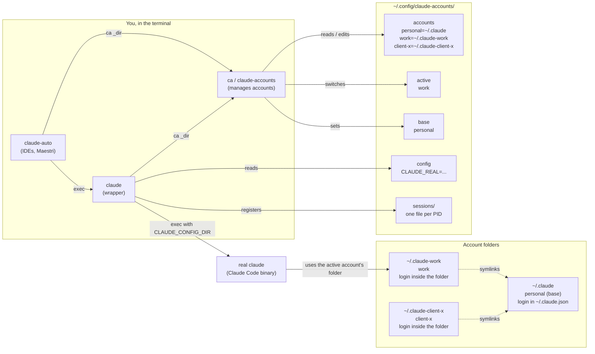
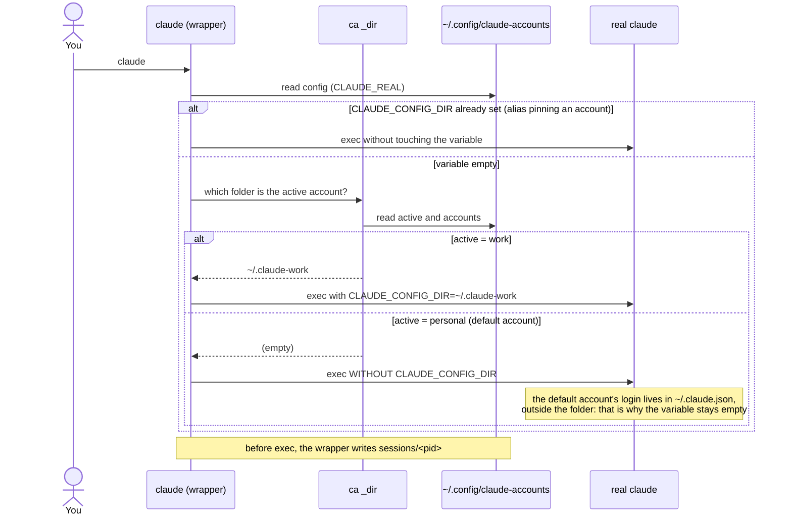
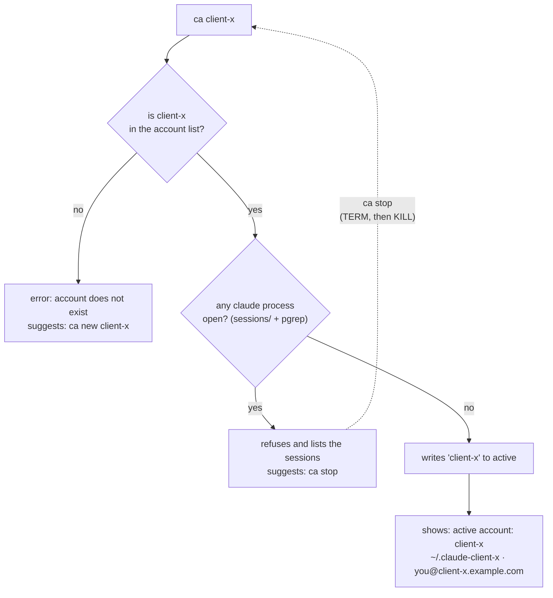
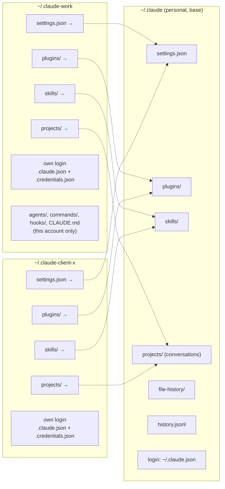
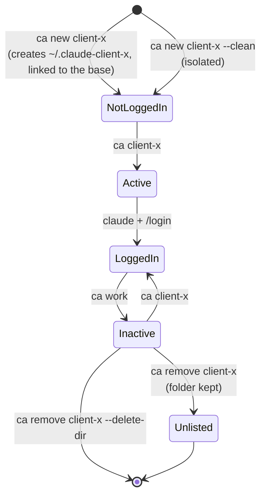
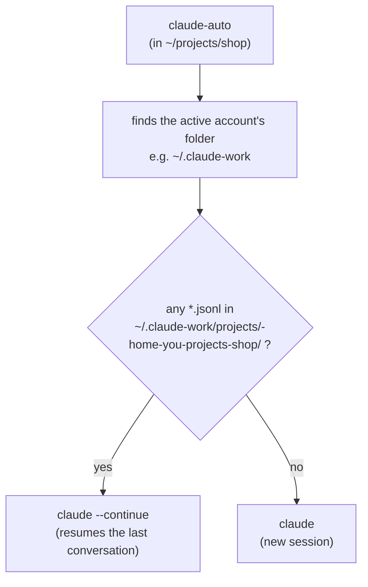

🇧🇷 [Leia em português](pt-BR/como-funciona.md)

# How it works

For anyone who wants to understand, adapt or fix it. You do not need this to use it.

## The idea

Claude Code keeps everything about an account (login, settings, conversations) in one folder. The `CLAUDE_CONFIG_DIR` environment variable says **which folder to use**. Switching accounts means switching that variable. `claude-accounts` automates it:

1. An **account list** (`~/.config/claude-accounts/accounts`), one per line:
   ```
   personal=~/.claude
   work=~/.claude-work
   ```
2. A file with the **active account** (`~/.config/claude-accounts/active`).
3. A **`claude` wrapper** placed *before* the real `claude` in PATH. When it starts, it looks up the active account, sets `CLAUDE_CONFIG_DIR` and execs the real `claude`.
4. **`ca`** (`claude-accounts`) edits the list, switches the active account and guards against mistakes.

```
you type:  claude
   → wrapper (first in PATH) asks `ca _dir` for the active account's folder
   → exports CLAUDE_CONFIG_DIR=~/.claude-work
   → execs the real claude
```

If `CLAUDE_CONFIG_DIR` is already set (for example by an alias that pins one account), the wrapper leaves it alone.

"The active account" is really **the account in effect here**, decided at every launch (first match wins):

1. `CLAUDE_CONFIG_DIR` already set → used as is;
2. `CLAUDE_ACCOUNT=NAME` → that account;
3. a `.claude-account` file in the current folder or any parent (`ca here NAME`) → that account;
4. otherwise the global account in `~/.config/claude-accounts/active` (`ca NAME`).

A pin or `CLAUDE_ACCOUNT` naming a missing account is an error, and so is an `active` file naming one (after a hand edit or a restored backup), so `claude` never silently starts on the wrong account. Details: [per-project-accounts.md](per-project-accounts.md).

## The default account is a special case

`~/.claude` is the account Claude Code uses **when `CLAUDE_CONFIG_DIR` is not set**. In that mode the login data lives in `~/.claude.json` (in your home, **outside** the folder). For the other accounts it lives **inside** the folder: `~/.claude-work/.claude.json`.

Consequences, already handled by the code:

- For the account whose folder is `~/.claude`, the wrapper **unsets** the variable instead of pointing it there. Setting `CLAUDE_CONFIG_DIR=~/.claude` would look for the login in `~/.claude/.claude.json`, which does not exist, and the account would look logged out.
- To show an account's email, `ca` reads the right file for each case (with `jq` if installed, otherwise a `sed` fallback).

## Sessions

The account is decided **when Claude starts**. A session that is already open stays on the old account. Switching anyway would leave you with processes on different accounts without noticing. So `ca NAME` refuses while any `claude` process is running, and `ca sessions` / `ca stop` help you deal with it.

How sessions are found:

- The wrapper registers every session it opens in `~/.config/claude-accounts/sessions/<pid>` (config folder, working directory, start time). Because the wrapper `exec`s Claude, the PID is Claude's own. This works on Linux, WSL and macOS. Stale entries are cleaned up automatically.
- Processes started **without** the wrapper are still found by name (`pgrep -x claude`). On Linux/WSL their account is read from `/proc/<pid>/environ`; elsewhere it shows as `(unknown)`, and `ca share` treats an unknown session conservatively (it refuses, since it might be on the account being linked).

The process name must stay `claude`: the installer records the `claude` link, not the versioned file behind it (`.../versions/2.x`), otherwise `pgrep` would miss those sessions.

`ca stop` sends `TERM`, waits up to 10 seconds, then `KILL`s whatever is left.

## `claude-auto`

`claude --continue` resumes the last conversation **of the current directory** and fails if that directory never had a session. Without the flag, reopening a terminal in an old directory starts empty. `claude-auto` checks whether `<account folder>/projects/<directory path>/*.jsonl` exists and picks `--continue` or a fresh start. It is meant for tools that always launch the same command.

When the last conversation became a **background session**, `--continue` refuses to open it. `claude-auto` checks `claude agents --json` first and, if that conversation is a background session, reopens the same session with `claude attach <id>`. If `--continue` still refuses at startup, it looks for the session in your other accounts (conversations are shared through `projects/`) and attaches with the account that owns it. It never starts a new session on its own: if nothing works, it prints the `claude --resume <id>` to use and stops.

## The base and sharing

The **base** (`~/.config/claude-accounts/base`) is just the name of the account that holds the real config. `ca new` links the new account to it by default; `--clean` turns that off; `--share OTHER` links to another account instead. `ca base OTHER` really moves the base: it moves the shared items to the new base and relinks everyone else.

Sharing creates symlinks from the account to these items of the source account: `projects`, `settings.json`, `plugins`, `skills`, `file-history`, `history.jsonl`. Both accounts then see the same conversations, plugins and settings; only the login differs. Items the source does not have yet are created there first (empty, or from the account's own copy), so they are linked from day one. Existing folders are merged into the source (no overwrite) and the original is kept as `<item>.before-share`. To change the list, edit the `SHAREABLE` variable in `bin/claude-accounts`.

## Where this shows up in practice

- The default account as "the account for everything" is confusing: [separate-default-account.md](separate-default-account.md).
- One config for every account, and what leaks: [shared-config.md](shared-config.md).
- Programs that open Claude, and usage meters: [maestri.md](maestri.md).
- macOS specifics (Keychain logins): [macos.md](macos.md).

## Files

| Where | What |
|---|---|
| `~/.local/share/claude-accounts/bin/` | `claude` (wrapper), `claude-accounts`, `claude-auto` |
| `~/.config/claude-accounts/accounts` | account list |
| `~/.config/claude-accounts/active` | active account |
| `~/.config/claude-accounts/base` | base account |
| `~/.config/claude-accounts/config` | path of the real `claude` (`CLAUDE_REAL`) |
| `~/.config/claude-accounts/lang` | UI language (`en` or `pt-BR`; set with `ca lang`) |
| `~/.config/claude-accounts/sessions/` | one file per session opened through the wrapper |
| `~/.zshrc` / `~/.bashrc` / `~/.bash_profile` | `# >>> claude-accounts >>>` block with PATH and the `ca` alias |

## Known limitations

- **The wrapper only applies where PATH sees it.** Programs that open Claude without reading your shell startup file get the real `claude` on the default account. Use `claude-auto` or the wrapper's full path.
- **Claude Code updates** touch the real binary, not the wrapper. If the binary's path changes, the wrapper looks for it in PATH; run `install.sh` again to record the new path. `ca doctor` tells you if something is off.
- **Sessions opened without the wrapper** show as `(unknown)` on macOS (no `/proc`).

## Diagrams

The accounts below are **fictional**:

| Account | Folder | Email | Role |
|---|---|---|---|
| `personal` | `~/.claude` | `you@example.com` | Claude's default account and the **base** |
| `work` | `~/.claude-work` | `you@work.example.com` | company account, **active** |
| `client-x` | `~/.claude-client-x` | `you@client-x.example.com` | a client's account |

### 1. Overview

Who is who: the commands, the state files and each account's folder.



### 2. What happens when you type `claude`

The wrapper comes before the real binary in `PATH`. It finds the active account's folder and only then opens Claude.



### 3. Switching with `ca NAME`

The account is decided when Claude starts, so switching refuses while a session is open.



### 4. Base and sharing

The **base** holds the real config. The other accounts point to it with symlinks; only the login is separate.



Result: install a plugin in `work` and it shows up in `client-x` and `personal`; a conversation opened in `client-x` can be resumed in `work` with `/resume`. Careful with `~/.claude/rules/`: it applies to **every** account, even without a link (see [shared-config.md](shared-config.md)). On macOS the token is in the Keychain rather than `.credentials.json` ([macos.md](macos.md)).

### 5. An account's lifecycle



Safety rules: you cannot remove the **active** account or the **base**, and `--delete-dir` refuses if another account still has links pointing into the folder.

### 6. `claude-auto`: continue or start fresh

For tools that always launch the same command.


