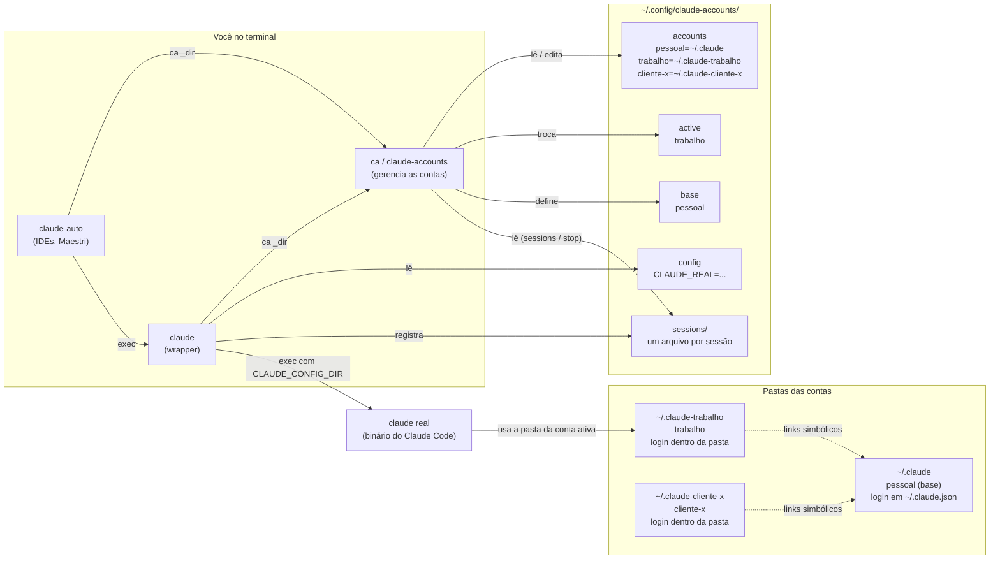
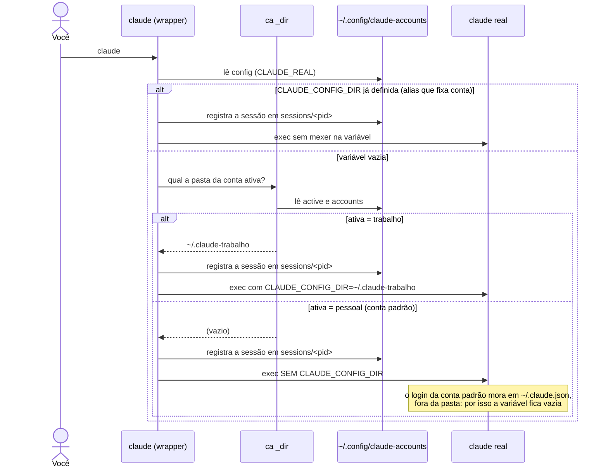
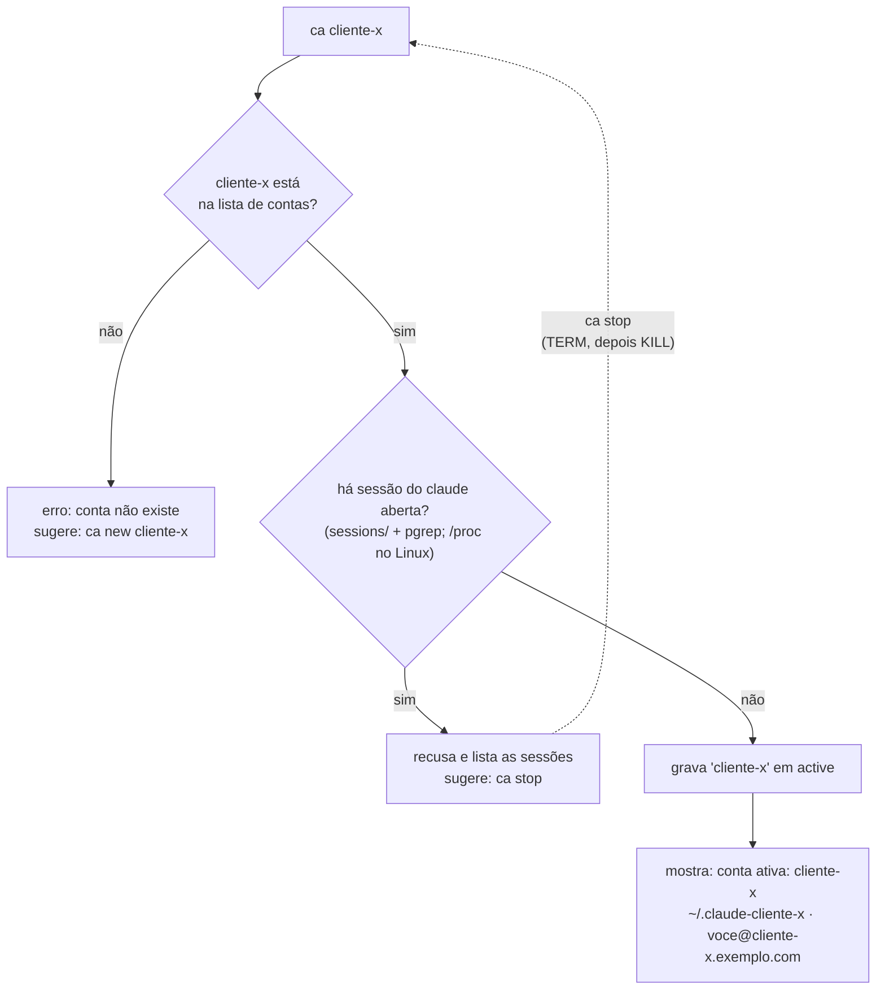
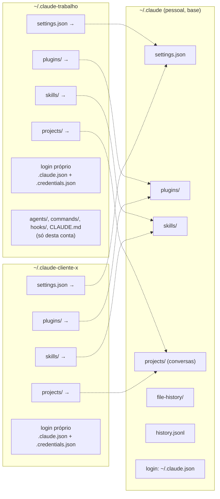
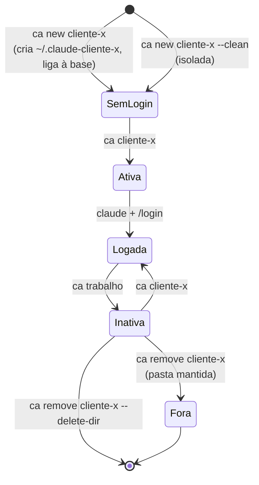
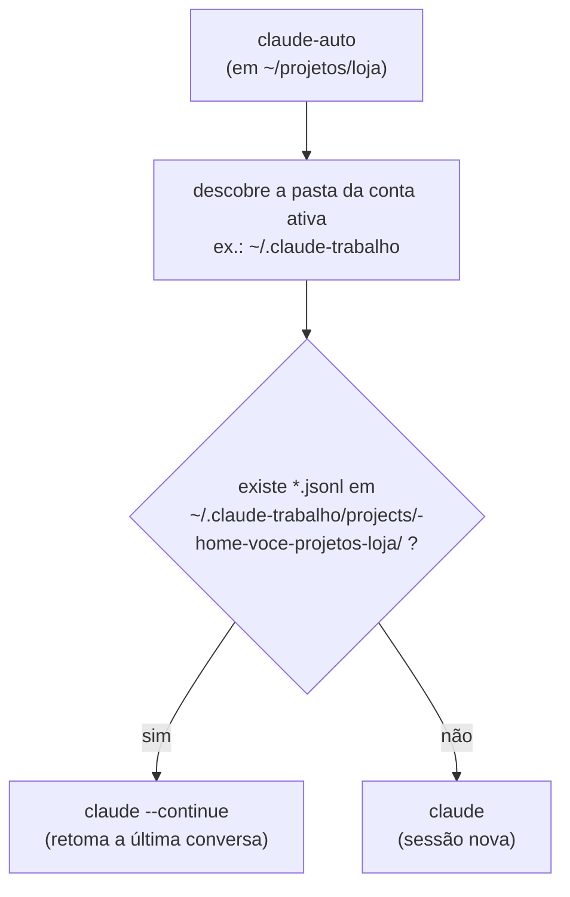

🇺🇸 [Read in English](../how-it-works.md)

# Como funciona

Para quem quer entender, adaptar ou consertar. Quem só quer usar não precisa ler.

## A ideia

O Claude Code guarda tudo de uma conta (login, configurações, conversas) numa pasta. A variável de ambiente `CLAUDE_CONFIG_DIR` diz **qual pasta usar**. Trocar de conta é trocar essa variável. O `claude-accounts` automatiza isso:

1. Uma **lista de contas** (`~/.config/claude-accounts/accounts`), uma por linha:
   ```
   pessoal=~/.claude
   trabalho=~/.claude-trabalho
   ```
2. Um arquivo com a **conta ativa** (`~/.config/claude-accounts/active`).
3. Um **wrapper `claude`** colocado *antes* do `claude` de verdade no PATH. Ao abrir, ele consulta a conta ativa, define `CLAUDE_CONFIG_DIR`, registra a sessão e chama o `claude` real.
4. O **`ca`** (`claude-accounts`) edita a lista, troca a ativa e protege contra erros.

```
você digita:  claude
   → wrapper (primeiro no PATH) pergunta ao `ca _dir` qual a pasta da conta ativa
   → exporta CLAUDE_CONFIG_DIR=~/.claude-trabalho
   → registra a sessão em ~/.config/claude-accounts/sessions/<pid>
   → exec do claude real
```

Se `CLAUDE_CONFIG_DIR` já estiver definida (por exemplo, um alias que fixa uma conta), o wrapper a respeita e não consulta a conta ativa.

"A conta ativa" é, na verdade, **a conta que vale aqui**, decidida a cada vez que o Claude abre (vale a primeira que bater):

1. `CLAUDE_CONFIG_DIR` já definida → usada como está;
2. `CLAUDE_ACCOUNT=NOME` → essa conta;
3. um arquivo `.claude-account` na pasta atual ou em alguma acima (`ca here NOME`) → essa conta;
4. senão, a conta global em `~/.config/claude-accounts/active` (`ca NOME`).

Fixação ou `CLAUDE_ACCOUNT` apontando para conta que não existe é erro, então o `claude` nunca abre na conta errada em silêncio. Detalhes: [contas-por-projeto.md](contas-por-projeto.md).

Tudo é bash puro e arquivos de texto: funciona em Linux, WSL e macOS (inclusive o bash 3.2 de fábrica do macOS). Não precisa de python; o e-mail de cada conta é lido com `jq` se ele existir, senão com `sed`.

## A conta padrão é um caso especial

A pasta `~/.claude` é a conta que o Claude usa **quando `CLAUDE_CONFIG_DIR` não está definida**. Nesse modo o login fica em `~/.claude.json` (na sua home, **fora** da pasta). Nas outras contas o login fica **dentro** da pasta: `~/.claude-trabalho/.claude.json`. (No macOS, o token em si fica no Keychain; veja [macos.md](macos.md).)

Consequências, já tratadas pelo código:

- Para a conta cuja pasta é `~/.claude`, o wrapper **não define** a variável. Apontar `CLAUDE_CONFIG_DIR=~/.claude` procuraria o login em `~/.claude/.claude.json`, que não existe, e a conta pareceria deslogada.
- Para ler o e-mail de uma conta, o `ca` olha o arquivo certo conforme o caso.

## Por que a troca recusa com sessão aberta

A conta é decidida **quando o Claude abre**. Uma sessão já aberta continua na conta antiga. Se trocasse mesmo assim, você teria processos de contas diferentes sem perceber. Por isso `ca NOME` falha enquanto houver sessão do Claude aberta, e `ca sessions` / `ca stop` ajudam a resolver.

Como as sessões são encontradas:

- **Pelo registro do wrapper.** Cada sessão aberta pelo wrapper ganha um arquivo `~/.config/claude-accounts/sessions/<pid>` (pasta da conta, diretório, hora de início). Isso funciona em qualquer sistema, inclusive macOS. Entradas de processos que já terminaram são apagadas sozinhas.
- **Pelo nome do processo** (`pgrep claude`), para pegar sessões abertas sem o wrapper. No Linux/WSL, a conta e o diretório delas são lidos de `/proc`. Onde não há `/proc` (macOS), elas aparecem como conta `(desconhecida)`, e o `ca share` recusa enquanto houver uma, por cautela.

O nome do processo precisa continuar `claude`: o wrapper chama o link `claude` e não o arquivo versionado por trás dele (`.../versions/2.x`), senão o `pgrep` não enxergaria as sessões.

## `claude-auto`

`claude --continue` retoma a última conversa **do diretório atual** e falha se o diretório nunca teve sessão. Sem a flag, reabrir um terminal num diretório antigo começa vazio. O `claude-auto` olha se existe conversa em `<pasta da conta>/projects/<caminho do diretório>/*.jsonl` e escolhe entre `--continue` e começar limpo. Serve para ferramentas que sempre chamam o mesmo comando (IDEs, Maestri, presets de terminal).

## A base e o compartilhamento

A **base** (`~/.config/claude-accounts/base`) é só o nome da conta que guarda a configuração de verdade. `ca new` liga a conta nova a ela por padrão; `--clean` desliga isso e `--share OUTRA` liga a outra conta. `ca base OUTRA` troca a base de verdade: move os itens compartilhados para a nova e religa as demais.

Ligar (`ca new`, `ca share`) cria links simbólicos de uma conta para estes itens da conta de origem: `projects`, `settings.json`, `plugins`, `skills`, `file-history`, `history.jsonl`. Assim as duas contas veem as mesmas conversas, plugins e configurações, e só o login difere. O que a conta já tinha é mesclado na origem e o original fica como `<item>.before-share`. Edite a variável `SHAREABLE` em `bin/claude-accounts` para mudar a lista.

## Idioma

As mensagens saem em inglês por padrão. `ca lang pt-BR` grava `pt-BR` em `~/.config/claude-accounts/lang`; `ca lang en` volta. A variável `CLAUDE_ACCOUNTS_LANG` tem prioridade sobre o arquivo.

## Onde isso aparece na prática

- A conta padrão como "conta de tudo" confunde: [conta-padrao-separada.md](conta-padrao-separada.md).
- Uma configuração para todas as contas, e o que vaza: [configuracao-compartilhada.md](configuracao-compartilhada.md).
- Programas que abrem o Claude e anéis de uso: [maestri.md](maestri.md).
- Particularidades do macOS: [macos.md](macos.md).

## Arquivos

| Onde | O quê |
|---|---|
| `~/.local/share/claude-accounts/bin/` | `claude` (wrapper), `claude-accounts`, `claude-auto` |
| `~/.config/claude-accounts/accounts` | lista de contas |
| `~/.config/claude-accounts/active` | conta ativa |
| `~/.config/claude-accounts/base` | conta base |
| `~/.config/claude-accounts/config` | caminho do `claude` real (`CLAUDE_REAL`) |
| `~/.config/claude-accounts/lang` | idioma das mensagens (`en` ou `pt-BR`) |
| `~/.config/claude-accounts/sessions/` | um arquivo por sessão aberta pelo wrapper |
| `~/.zshrc` / `~/.bashrc` / `~/.bash_profile` | bloco `# >>> claude-accounts >>>` com PATH e alias `ca` |

## Limitações conhecidas

- **Wrapper só vale onde o PATH o enxerga.** Programas que abrem o Claude sem ler o arquivo do shell caem no `claude` real e usam a conta padrão. Use `claude-auto` ou o caminho completo do wrapper.
- **Atualizações do Claude Code** mexem no binário real, não no wrapper. Se o caminho gravado em `CLAUDE_REAL` deixar de existir, o wrapper procura o `claude` no PATH; para fixar o caminho novo, rode o `install.sh` de novo. `ca doctor` mostra se algo está fora do lugar.
- **Sessões abertas sem o wrapper** no macOS não têm a conta identificada (aparecem como `(desconhecida)`).

## Diagramas

As contas aqui são **fictícias**:

| Conta | Pasta | E-mail | Papel |
|---|---|---|---|
| `pessoal` | `~/.claude` | `voce@exemplo.com` | conta padrão do Claude e **base** |
| `trabalho` | `~/.claude-trabalho` | `voce@trabalho.exemplo.com` | conta da empresa, **ativa** |
| `cliente-x` | `~/.claude-cliente-x` | `voce@cliente-x.exemplo.com` | conta de um cliente |

### 1. Visão geral

Quem é quem: os comandos, os arquivos de estado e as pastas de cada conta.



### 2. O que acontece quando você digita `claude`

O wrapper vem antes do binário real no `PATH`. Ele descobre a pasta da conta ativa e só então abre o Claude.



### 3. Trocar de conta com `ca NOME`

A conta é decidida quando o Claude abre. Por isso a troca recusa se houver sessão aberta.



### 4. Base e compartilhamento

A **base** guarda a configuração de verdade. As outras contas apontam para ela por links simbólicos; só o login fica separado.



Resultado: instalou um plugin na `trabalho`, ele aparece na `cliente-x` e na `pessoal`; uma conversa aberta na `cliente-x` pode ser retomada na `trabalho` com `/resume`. Cuidado com `~/.claude/rules/`: vale para **todas** as contas, mesmo sem link (ver [configuracao-compartilhada.md](configuracao-compartilhada.md)). No macOS, o token de login fica no Keychain em vez de `.credentials.json`.

### 5. Ciclo de vida de uma conta



Regras de proteção: não dá para remover a conta **ativa** nem a **base**, e `--delete-dir` recusa se outra conta ainda tiver links apontando para dentro dela.

### 6. `claude-auto`: continuar ou começar do zero

Para ferramentas que sempre chamam o mesmo comando.


